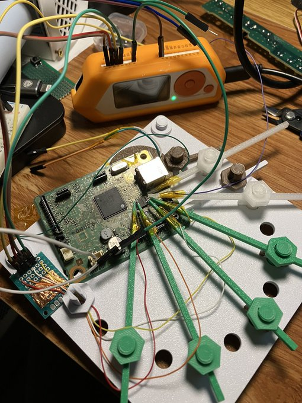

# Canon PIXMA MG2550s replacement firmware

Work toward a fully open-source replacement for the printer and scanner firmware.
The current C application supports mechanical scanner homing, measured forward
motion and a full-page grayscale scan proof of concept. A physical 880-row scan
completed and returned the scanner home. Image calibration, colour scanning and
printing remain unfinished.

**Start with the [application guide](app/README.md)** for current capabilities,
build and emulator instructions, USB installation, scan commands and limitations.

- [Bootloader](bootloader/README.md): flash layout, USB/I²C recovery and installation.
- [Host tools](tools/README.md): firmware management and ESP32 recovery bridge.
- [Emulator](emu/README.md): stock-firmware experiments and replacement-firmware tests.

Normal application updates preserve the first 64 KiB containing both recovery
stages. Validate firmware changes in emulation before flashing.

